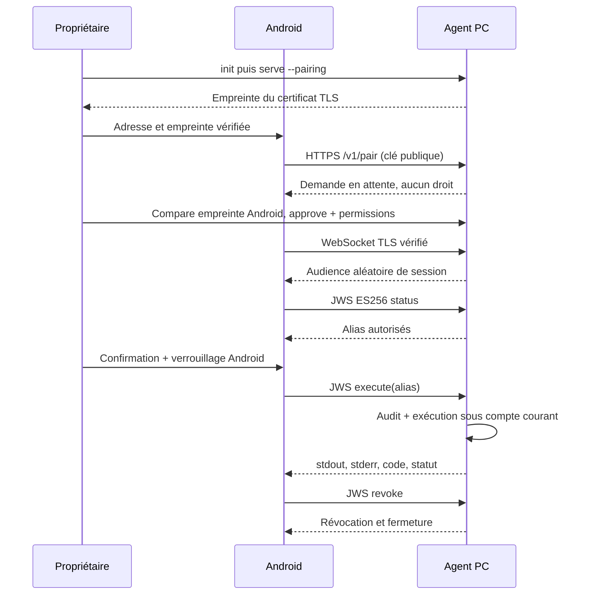

# Architecture et décisions

DuckyBridge 0.1 est une première tranche du MVP local, pas l'ensemble de la V1 du cahier des charges. L'unité de confiance est un couple téléphone/agent approuvé explicitement. Il n'existe aucun serveur central, télémétrie, relais Internet ou ouverture de port automatique.

## Monorepo

- `android-app` : Kotlin, Compose Material 3, ViewModel + StateFlow, coroutines, Room, DataStore, Android Keystore et OkHttp.
- `desktop-agent` : bibliothèque Rust testable et CLI native ; Tokio, axum, rustls, rcgen, jsonwebtoken, keyring, mdns-sd.
- `shared-protocol` : contrat de communication, schéma JSON et exemple de script.
- `docs`, `scripts`, `.github/workflows` : installation, sécurité, validation et CI.

## Décisions

| Décision | Justification et compromis |
|---|---|
| WebSocket TLS plutôt que gRPC | Bidirectionnel pour résultat et annulation ; client Android léger ; pas de génération protobuf. JSON versionné inspectable. Contrats stricts côté Rust. |
| TLS agent + signatures client JWS ES256 | Réutilise Keystore et des bibliothèques standards. Évite d'exporter la clé Android ou d'installer une autorité globale. Différent de mTLS ; une revue indépendante reste nécessaire. |
| Empreinte copiée depuis le PC | Amorce de confiance explicite hors réseau. mDNS suggère des adresses, jamais une identité approuvée. |
| Programmes/arguments fixes locaux | Premier parcours auditable, sans interpréteur shell ni élévation. L'utilisateur choisit les droits séparément pour chaque appareil. |
| Permissions relues à chaque opération | Révocation effective sans redémarrage, y compris fermeture des sessions actives. La politique programmes/répertoire est chargée au démarrage. |
| Processus manuel sous compte courant | Aucune installation de service privilégié, tâche planifiée ou modification de pare-feu implicite. |
| Room et DataStore | Données métier observables et préférences indépendantes ; aucune clé privée dans Room. Sauvegarde Android désactivée. |

## Flux principal

## Persistance et concurrence

L'agent utilise des JSON locaux protégés par un verrou interprocessus ; écrit un fichier temporaire synchronisé avant remplacement atomique via `tempfile::NamedTempFile::persist`. La durabilité face à une panne électrique doit encore être testée, notamment la synchronisation du répertoire. Le magasin absent/illisible entraîne le refus des commandes. `config.json` ne contient que programmes autorisés, répertoire, nom et identifiant public. `devices.json` contient clés publiques, permissions et expiration ; `pending.json` contient les demandes temporaires. `audit.jsonl` contient les métadonnées d'opérations, jamais JWT, clés privées ou sortie de commande. Rotation et journal résistant à un administrateur malveillant restent à développer.

La VM Android gère un seul appareil actif et conserve plusieurs appareils. Les scripts sont exécutés séquentiellement, arrêtent au premier échec, peuvent attendre et conditionner une étape au code précédent. Leur simulation vérifie seulement les alias, structure et délais ; elle ne prédit pas les effets d'une commande. Variables, branches générales, coloration syntaxique et transferts sont hors de cette tranche.

Les commandes ne sont jamais rejouées automatiquement après une coupure. La reconnexion est actuellement manuelle. Aucun indicateur de disponibilité ne reste vert après fermeture de session ; la dernière connexion est persistée séparément.
